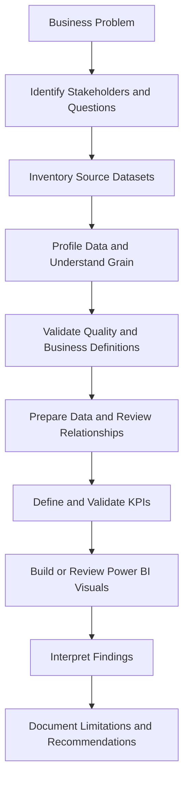
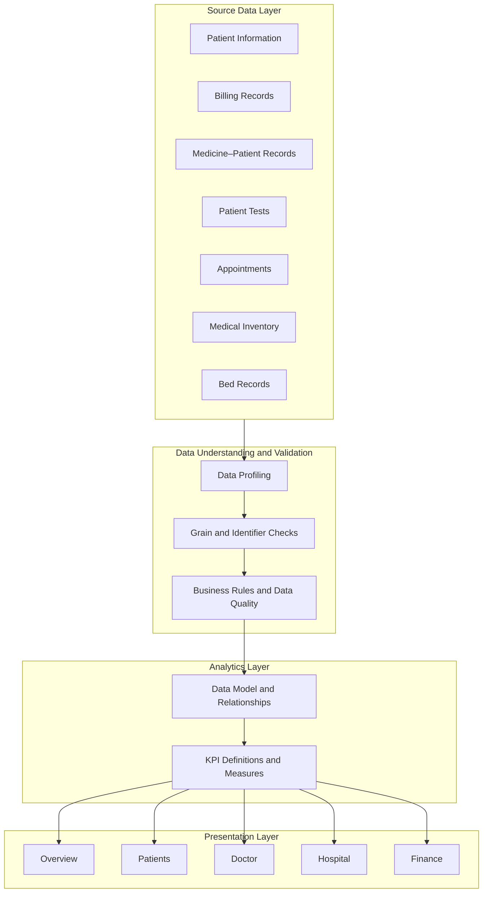

<div align="center">

# 🏥 MediScope
## Hospital Intelligence & Performance Analytics

### Turning Hospital Data into Business Insights

**An end-to-end healthcare analytics portfolio project focused on hospital operations, patient activity, doctor-related information, bed availability, financial analysis, and medical inventory.**

<br>


<br>

**Explore the data. Understand the operations. Support better decisions.**

</div>

---

## 📌 Table of Contents

- [1. Project Overview](#-1-project-overview)
- [2. The Business Problem](#-2-the-business-problem)
- [3. Project Objectives](#-3-project-objectives)
- [4. Who Can Use These Insights?](#-4-who-can-use-these-insights)
- [5. Project Scope](#-5-project-scope)
- [6. Dashboard Overview](#-6-dashboard-overview)
- [7. Data Inventory](#-7-data-inventory)
- [8. Analytical Workflow](#-8-analytical-workflow)
- [9. Project Architecture](#-9-project-architecture)
- [10. Business Questions](#-10-business-questions)
- [11. KPI Framework](#-11-kpi-framework)
- [12. Initial Data Profiling and Observations](#-12-initial-data-profiling-and-observations)
- [13. Data Quality and Validation](#-13-data-quality-and-validation)
- [14. Technology Stack](#-14-technology-stack)
- [15. Repository Structure](#-15-repository-structure)
- [16. How to Run the Project](#-16-how-to-run-the-project)
- [17. How to Explore the Dashboard](#-17-how-to-explore-the-dashboard)
- [18. Business Value](#-18-business-value)
- [19. Project Limitations](#-19-project-limitations)
- [20. Future Improvements](#-20-future-improvements)
- [21. Responsible Data Use and Privacy](#-21-responsible-data-use-and-privacy)
- [22. Project Attribution](#-22-project-attribution)
- [23. Author](#-23-author)

---

# 🏥 1. Project Overview

**MediScope — Hospital Intelligence & Performance Analytics** is a healthcare analytics project designed to explore how hospital-related datasets can be organized, analyzed, and presented through an interactive Power BI dashboard.

Hospitals generate data across multiple operational areas, including patient registration, appointments, doctor information, bed management, billing, medical tests, and inventory. When this information is distributed across separate files or tables, it can be difficult for decision-makers to develop a consistent view of hospital performance.

MediScope brings these analytical areas into a common dashboard experience, allowing users to explore the available information and investigate questions related to hospital operations and financial activity.

Rather than treating visualization as the final objective, the project emphasizes a broader business analytics process:

- Understanding the business problem.
- Identifying relevant datasets and their limitations.
- Defining measurable business questions.
- Establishing meaningful KPI definitions.
- Examining data quality and consistency.
- Presenting information through dashboards.
- Translating observations into potential business actions.
- Documenting assumptions so that findings are interpreted correctly.

The project is intended as a **portfolio and learning project**. Its findings should not be interpreted as validated evidence of the performance of a real hospital.

### The central idea

> Healthcare analytics is not just about displaying numbers. It is about understanding what those numbers represent, determining whether they are reliable, and identifying what decisions they can reasonably support.

---

# 🎯 2. The Business Problem

## 2.1 Business Context

Hospital management involves several interconnected operational functions.

| Business area | Typical management challenge | Analytical opportunity |
|---|---|---|
| Patient management | Understanding patient activity and recorded admission status | Patient-level and status analysis |
| Appointments | Reviewing appointment records and scheduling activity | Appointment trend and status analysis |
| Doctor management | Understanding available doctor-related information | Doctor-level analysis, subject to data-grain validation |
| Bed management | Understanding recorded bed availability | Available and occupied bed reporting |
| Billing | Understanding the distribution of billed amounts | Billing breakdown and financial reconciliation |
| Medical inventory | Identifying stock-related information and potential expiry risks | Inventory monitoring and exception reporting |
| Hospital reporting | Combining information from separate datasets | Centralized reporting and consistent KPI definitions |

These are common hospital analytics challenges. The extent to which this project can answer each question depends on the fields, relationships, definitions, and reporting periods available in the source data.

## 2.2 Problem Statement

Hospital-related information may be distributed across multiple spreadsheets containing patient records, bills, appointments, tests, beds, doctor-related information, and medical stock.

Without a consistent analytical view, stakeholders may find it difficult to understand the information efficiently, compare operational indicators, investigate unusual values, or identify areas requiring further review.

**MediScope addresses this problem by organizing the available hospital-related data into a dashboard-oriented analytical experience and documenting how the information can be interpreted responsibly.**

The project also recognizes an important issue: a dashboard is only as reliable as its underlying data, business definitions, and calculations.

Therefore, data validation and interpretation are integral parts of the analytical process.

## 2.3 Why This Problem Matters

In a hospital environment, incorrect interpretation of data can have practical consequences.

For example:

- Counting repeated patient records as unique patients can inflate patient totals.
- Summing salary values repeated across transactional records can overstate salary expenses.
- Treating billed amounts as collected revenue can misrepresent financial performance.
- Calculating bed utilization from a single snapshot can produce an incorrect operational KPI.
- Using inconsistent patient-status fields can lead to conflicting admission and discharge reports.
- Ignoring outdated inventory records can result in misleading stock-risk assessments.

MediScope therefore focuses on both **analytical visibility and the validation required to make that visibility trustworthy**.

---

# 🚀 3. Project Objectives

The project has the following objectives.

### Objective 1 — Centralize analytical visibility

Bring the available hospital-related datasets into a structured dashboard experience.

### Objective 2 — Understand patient activity

Explore the available patient information and recorded status fields while distinguishing patient counts from transaction counts.

### Objective 3 — Examine doctor-related information

Investigate the doctor-related fields available in the source data and identify whether they support reliable doctor-level reporting.

### Objective 4 — Explore bed availability

Analyze recorded bed-status information and distinguish a point-in-time snapshot from a time-based utilization metric.

### Objective 5 — Analyze financial records

Examine bill values and category-level distributions while validating the meaning of financial fields before labeling them as revenue, collections, expenses, or profit.

### Objective 6 — Review medical inventory

Explore stock, reorder, supplier, and expiry-related fields where available.

### Objective 7 — Establish data-quality controls

Identify inconsistent statuses, repeated values, missing definitions, stale dates, and other issues that may affect reporting.

### Objective 8 — Apply business analysis thinking

Connect data exploration to business questions, KPI definitions, assumptions, limitations, and potential recommendations.

### Objective 9 — Develop a reproducible portfolio project

Document the datasets, analytical logic, project structure, and steps needed for another person to review the work.

---

# 👥 4. Who Can Use These Insights?

The dashboard is organized around analytical areas that may be relevant to different hospital stakeholders.

| Stakeholder | Potential analytical interest |
|---|---|
| Hospital administrator | High-level operational visibility |
| Operations manager | Patient activity and bed-status information |
| Finance manager | Bill values and financial breakdowns |
| Inventory manager | Stock, reorder, and expiry information |
| Doctor or department coordinator | Available doctor-related and patient-related information |
| Business analyst | KPI definitions, business questions, data validation, and reporting requirements |
| Data analyst | Data structure, aggregation logic, model relationships, and visualization |
| Management team | A consolidated view of selected hospital indicators |

These are **potential users of the analysis**, not confirmed users of a deployed system. The project has not been established as a live hospital decision-support platform.

---

# 🧭 5. Project Scope

## 5.1 Included in the Project

The current project scope covers:

- A Power BI dashboard with six reported pages.
- Exploration of the available hospital-related Excel datasets.
- Patient-related data analysis.
- Doctor-related data exploration.
- Bed-status analysis.
- Billing and financial breakdowns.
- Medical inventory exploration.
- Business-question formulation.
- KPI interpretation and validation considerations.
- Documentation of data-quality issues and limitations.

## 5.2 Outside the Current Scope

The project should not be represented as including the following unless those capabilities are independently implemented and verified:

- Live integration with a hospital information system.
- Real-time monitoring of hospital operations.
- Electronic medical record integration.
- Clinical decision support.
- Diagnosis or treatment recommendations.
- Predictive patient outcomes.
- Machine-learning-based forecasting.
- Automated hospital resource allocation.
- Production-grade role-based access control.
- Validated patient-level operational alerts.
- Automated financial reconciliation with an accounting system.

### Scope principle

The objective is to demonstrate analytical thinking and reporting capabilities using the available data—not to claim capabilities that have not been built or validated.

---

# 📊 6. Dashboard Overview

The dashboard is organized into six reported pages.

## Page 1 — Home

**Purpose:** Provide an entry point to the dashboard.

Potential role:
- Introduce the project.
- Provide navigation to the analytical sections.
- Establish a consistent visual identity.

The exact navigation and landing-page elements should be confirmed against the published PBIX file.

## Page 2 — Overview

**Purpose:** Present a high-level view of the available hospital indicators.

Potential business use:
- Orient users before they explore individual operational areas.
- Provide a consolidated reporting entry point.
- Highlight the indicators selected for management review.

The exact KPI names, calculations, and filters should be documented after inspecting the dashboard measures.

## Page 3 — Patients

**Purpose:** Explore patient-related information.

Potential business questions:
- How many unique patients are represented?
- How are patient records distributed across the available status categories?
- What patient attributes are available for analysis?
- Are patient-level counts consistent with the underlying data?

A unique-patient KPI requires a validated patient identifier and an appropriate counting method.

## Page 4 — Doctor

**Purpose:** Explore doctor-related information available in the source datasets.

Potential business questions:
- How many unique doctor identifiers are present?
- Which doctor attributes are available?
- Are doctor-related financial fields stored at doctor level or repeated across patient records?
- Can doctor-level totals be calculated without double-counting?

The existence of doctor-related columns does not automatically mean that the source data supports reliable doctor performance or productivity analysis.

## Page 5 — Hospital

**Purpose:** Explore hospital-related operational information, including the available bed records.

Potential business questions:
- How many bed records are available?
- How many beds are recorded as available or occupied?
- Are bed identifiers unique?
- Does the dataset represent one snapshot or multiple periods?
- Is the information sufficient to calculate occupancy over time?

A bed-status snapshot and a time-based bed-utilization KPI are different measures and should not be used interchangeably.

## Page 6 — Finance

**Purpose:** Explore billing-related records and financial breakdowns.

Potential business questions:
- What is the total of the recorded bill-value field?
- How are bill values distributed across the available categories?
- What payment-status values are recorded?
- Do bill totals reconcile with the underlying records?
- Does the dataset distinguish billed amounts, discounts, payments, refunds, and outstanding balances?

Financial terminology must follow the actual definitions in the source data.

### Dashboard screenshots

Add screenshots to the repository and use the following section to make the dashboard easier to explore.

Replace the filenames if your actual screenshots use different names.

| Dashboard page | Preview |
|---|---|
| Home | `screenshots/home.png` |
| Overview | `screenshots/overview.png` |
| Patients | `screenshots/patients.png` |
| Doctor | `screenshots/doctor.png` |
| Hospital | `screenshots/hospital.png` |
| Finance | `screenshots/finance.png` |

Once the images exist in your repository, you can display them directly in this README. For example:

```markdown
## Dashboard Preview


```

**Note:** These filenames are suggested placeholders. Add the actual exported screenshots before enabling the image links.

---

# 🗂️ 7. Data Inventory

The project has been described as using seven Excel workbooks.

Initial profiling identified the following record counts:

| No. | Workbook | Rows | Columns | Analytical area |
|---:|---|---:|---:|---|
| 1 | `patient_info.xlsx` | 30 | 48 | Patient information |
| 2 | `bills.xlsx` | 210 | 6 | Billing and financial records |
| 3 | `medicine_patient.xlsx` | 517 | 6 | Medicine-related patient records |
| 4 | `patient_tests.xlsx` | 30 | 14 | Patient test information |
| 5 | `appointments.xlsx` | 35 | 15 | Appointment records |
| 6 | `medical_stock_info.xlsx` | 15 | 13 | Medical inventory |
| 7 | `Beds.xlsx` | 25 | 6 | Bed-related information |

**Total across the seven workbooks: 862 rows**, before any transformations or joins.

This is the sum of the individual workbook row counts, not a count of unique patients, unique hospital transactions, or unique entities across the project.

The counts reflect the initial workbook profiling and should be rechecked if the files are modified.

## 7.1 Patient Information

**Source:** `patient_info.xlsx`

**Initial profile:** 30 rows and 48 columns.

Intended analytical area:
- Patient attributes.
- Patient identifiers.
- Recorded patient-status information.

Validation requirements:
- Identify the correct unique patient key.
- Check for duplicate patient identifiers.
- Establish the definitions of the patient-status fields.
- Confirm the reporting period.
- Protect any personal or medical information.

The presence of multiple status fields requires clarification before a definitive admission or discharge KPI is published.

## 7.2 Billing Records

**Source:** `bills.xlsx`

**Initial profile:** 210 rows and 6 columns.

Intended analytical area:
- Bill-value analysis.
- Financial category breakdowns.
- Payment-status exploration.

Validation requirements:
- Establish whether each row represents a bill, a bill item, or another transaction grain.
- Confirm the meaning of the `Value` field.
- Check whether discounts are stored as positive or negative values.
- Confirm whether refunds, taxes, adjustments, or unpaid amounts are represented.
- Reconcile aggregate values against the underlying records.

## 7.3 Medicine–Patient Records

**Source:** `medicine_patient.xlsx`

**Initial profile:** 517 rows and 6 columns.

Intended analytical area:
- Medicine-related records associated with patients.
- Exploration of available medicine and patient fields.

Validation requirements:
- Identify the row-level grain.
- Check repeated patient and medicine identifiers.
- Establish whether the data represents prescriptions, medicine items, dispensed quantities, or another activity.
- Avoid treating the row count as a patient count.

## 7.4 Patient Tests

**Source:** `patient_tests.xlsx`

**Initial profile:** 30 rows and 14 columns.

Intended analytical area:
- Patient test information.
- Exploration of available test-related fields.

Validation requirements:
- Confirm whether each row represents a patient, test, test order, or another entity.
- Check whether multiple tests can belong to the same patient.
- Establish whether dates and result fields are available and meaningful.

## 7.5 Appointments

**Source:** `appointments.xlsx`

**Initial profile:** 35 rows and 15 columns.

Intended analytical area:
- Appointment records.
- Exploration of scheduling and appointment-status fields.

Validation requirements:
- Confirm the appointment identifier.
- Determine whether multiple appointments can belong to the same patient.
- Check date formats and status definitions.
- Avoid inferring appointment completion or cancellation unless the fields support those conclusions.

## 7.6 Medical Inventory

**Source:** `medical_stock_info.xlsx`

**Initial profile:** 15 rows and 13 columns.

Intended analytical area:
- Medical stock information.
- Reorder-related fields.
- Supplier information.
- Expiry-related fields.

Validation requirements:
- Confirm the meaning and units of stock quantities.
- Verify the reorder threshold and reorder-quantity definitions.
- Confirm that expiry dates are valid.
- Check the data's reporting date before describing stock as currently available or expired.

## 7.7 Bed Records

**Source:** `Beds.xlsx`

**Initial profile:** 25 rows and 6 columns.

Intended analytical area:
- Bed identifiers and recorded status.
- Available versus occupied bed counts.

Validation requirements:
- Check whether each row represents one unique bed.
- Validate the status values.
- Establish whether the dataset is a single snapshot or a historical series.
- Confirm whether all relevant bed categories are included.

### Important data-grain principle

A dataset's row count is not necessarily the number of unique people, bills, appointments, doctors, tests, or beds.

Before defining a KPI, determine **what one row represents**, which identifier uniquely identifies that entity, and whether the same entity appears in other records.

---

# 🔄 8. Analytical Workflow

The project follows a structured analytical workflow.



## Step 1 — Understand the business problem

Identify what hospital stakeholders may need to understand and why the information matters.

## Step 2 — Inventory the data

Review the available workbooks, their fields, row counts, identifiers, dates, and business meanings.

## Step 3 — Profile the data

Check for:
- Missing values.
- Duplicate identifiers.
- Repeated records.
- Inconsistent categories.
- Invalid dates.
- Unexpected numeric values.
- Inconsistent units.
- Potential privacy risks.

## Step 4 — Validate data relationships

Determine how patient, bill, appointment, test, doctor-related, medicine, bed, and inventory records relate to one another.

Do not assume that similarly named columns establish valid relationships.

## Step 5 — Define KPIs

Document each metric's:
- Business definition.
- Formula.
- Data source.
- Row-level grain.
- Filters and reporting period.
- Validation checks.
- Known limitations.

## Step 6 — Develop or review the dashboard

Organize the analytical outputs into useful dashboard pages.

Review whether the visual type, aggregation, filters, and labels match the underlying business question.

## Step 7 — Interpret the results

Distinguish between:
- What the data directly shows.
- What the data suggests.
- What still needs validation.
- What cannot reasonably be concluded.

## Step 8 — Document the analysis

Make assumptions, data-quality issues, and limitations visible so that another analyst can reproduce and challenge the findings.

---

# 🏗️ 9. Project Architecture

The following diagram describes the **logical analytical workflow**, not a verified diagram of the exact Power BI data model.



The actual Power BI relationships, transformations, measures, and dependencies must be inspected before this logical architecture is presented as the implemented technical architecture.

## 9.1 Why Data Modeling Matters

Hospital datasets often have different grains.

For example:

- A patient table may contain one row per patient.
- A billing table may contain one row per bill or bill item.
- A medicine table may contain multiple records per patient.
- An appointment table may contain multiple appointments per patient.
- A bed table may contain one row per bed or one row per bed-status event.

Joining these tables without understanding their grains can multiply records and inflate totals.

A reliable model must account for identifiers, relationship cardinality, filter direction, and the appropriate aggregation for each metric.

---

# ❓ 10. Business Questions

The following questions form the business-analysis framework for MediScope.

They are intended to guide exploration; they are not all confirmed capabilities of the current dashboard.

## 10.1 Patient Analytics

1. How many unique patients are represented in the dataset?
2. What patient-status categories are recorded?
3. Are the status fields consistent with one another?
4. Are there duplicate patient identifiers?
5. Which patient attributes can be analyzed safely and meaningfully?
6. What additional fields would be needed for reliable patient-flow analysis?

## 10.2 Doctor Analytics

1. How many unique doctor identifiers are present?
2. Which doctor attributes are available?
3. Are doctor-related amounts repeated across patient-level records?
4. Can doctor-level totals be calculated without double-counting?
5. Is the data sufficient to measure doctor workload or productivity?
6. What additional appointment or activity data would be required?

## 10.3 Hospital and Bed Analytics

1. How many bed records are available?
2. How many beds are recorded as available or occupied?
3. Are bed identifiers unique?
4. Does the dataset contain a timestamp or reporting date?
5. Can the data support occupancy analysis over time?
6. What information would be required to calculate bed turnaround time?

## 10.4 Financial Analytics

1. What is the sum of the recorded bill-value field?
2. How are values distributed across billing categories?
3. What payment statuses are recorded?
4. Can the total be reconciled to individual records?
5. Are discounts, refunds, taxes, and adjustments represented consistently?
6. Does the data distinguish billed amounts from collected payments?
7. What additional data would be needed to calculate outstanding balances?

## 10.5 Inventory Analytics

1. Which stock-related fields are available?
2. Are reorder thresholds defined?
3. Which items may require a stock review?
4. Are expiry dates available and valid?
5. What reporting date should be used for expiry-risk analysis?
6. Is stock movement history available?
7. Can the dataset support inventory turnover or stockout analysis?

## 10.6 Data Governance

1. What does one row represent in each dataset?
2. Are unique identifiers consistent across files?
3. Which fields contain personal or sensitive information?
4. What is the source and reporting period of each dataset?
5. Which KPIs have approved business definitions?
6. Which assumptions need stakeholder confirmation?

---

# 📐 11. KPI Framework

A KPI should be more than a number displayed on a card.

Each KPI requires a business definition, a valid calculation, an appropriate data grain, and clear limitations.

The formulas below are **candidate definitions for analytical development**. They must not be interpreted as confirmed implementations of the current PBIX file.

| KPI | Candidate definition | Validation required |
|---|---|---|
| Unique patients | Distinct count of the validated patient identifier | Confirm the patient key |
| Recorded patient count by status | Distinct patient count filtered by a validated status field | Resolve status definitions |
| Bill-value total | Sum of the validated bill-value field | Confirm financial meaning and sign convention |
| Average bill value | Validated bill-value total divided by the appropriate number of bills | Confirm one row per bill or use distinct bill IDs |
| Available beds | Count of unique beds with an approved available status | Confirm unique bed IDs and status definitions |
| Occupied beds | Count of unique beds with an approved occupied status | Confirm unique bed IDs and status definitions |
| Bed occupancy rate | Occupied beds divided by eligible total beds, for a defined snapshot | Validate the denominator and reporting timestamp |
| Appointment count | Count of valid appointment identifiers | Confirm appointment grain |
| Medicine record count | Count of medicine-related records | Do not label this as unique medicines or patients without validation |
| Inventory items requiring reorder | Count of eligible items below a validated reorder threshold | Confirm quantity units and threshold definitions |
| Inventory items past expiry | Count of eligible items whose expiry date precedes the defined reporting date | Validate dates and item grain |

## 11.1 Example KPI Definitions

### A. Unique Patients

**Business question:** How many distinct patients are represented in the dataset?

Conceptual formula:

```text
Unique Patients = DISTINCTCOUNT(Patient ID)
```

The patient identifier must be validated first. A row count is not an adequate substitute if patient records can be duplicated.

### B. Total Bill Value

**Business question:** What is the total value of the selected billing records?

Conceptual formula:

```text
Total Bill Value = SUM(Validated Bill Value)
```

The metric should initially be labeled according to the source field's meaning. It should not automatically be described as revenue collected, net revenue, or profit.

### C. Average Bill Value

**Business question:** What is the average bill value for the selected population of bills?

Conceptual formula:

```text
Average Bill Value = Validated Bill Value Total / Number of Distinct Bills
```

This calculation is appropriate only after confirming the bill identifier, the row grain, and the treatment of discounts, refunds, and adjustments.

### D. Bed Occupancy Rate

**Business question:** What proportion of eligible beds are occupied at a defined point in time?

Conceptual formula:

```text
Bed Occupancy Rate =
Occupied Eligible Beds / Total Eligible Beds × 100
```

A valid definition must establish:
- The reporting timestamp.
- The eligible bed population.
- The definition of occupied.
- The handling of unavailable, closed, or out-of-service beds.

A snapshot can support a snapshot occupancy calculation if these conditions are met. It cannot, by itself, establish occupancy over an entire day, month, or year.

### E. Inventory Reorder Flag

**Business question:** Which inventory items may require replenishment?

Illustrative rule:

```text
Reorder Review Required =
Stock Quantity < Reorder Threshold
```

This is only a candidate rule. The project must verify whether the relevant columns contain comparable quantities and whether the threshold applies to the same unit of measurement.

## 11.2 KPI Documentation Standard

For a production-quality analytics project, document each KPI in a consistent format:

| Documentation field | Description |
|---|---|
| KPI name | The metric's business name |
| Business question | The decision or question it supports |
| Definition | Exactly what is being measured |
| Formula | Calculation logic |
| Source table | Dataset containing the required fields |
| Grain | Entity or event being counted |
| Filters | Statuses, periods, and exclusions |
| Validation | Checks used to establish reliability |
| Limitations | Known weaknesses or missing information |
| Owner | Stakeholder responsible for confirming the definition |

This structure helps prevent inconsistent calculations and makes the dashboard easier to maintain.

---

# 🔍 12. Initial Data Profiling and Observations

Initial profiling identified several findings worth investigating before the dashboard is used for decision-making.

These observations describe the supplied dataset as initially reviewed. They do not establish the current condition of a real hospital.

## 12.1 Billing Records

Initial profiling found:

- **210 billing rows**
- A summed `Value` field of **727,105** across those rows
- All 210 rows were observed with the payment status `Paid`

The total is a dataset calculation, not independently verified revenue or cash collected.

The `Paid` status should also be validated against the source system's definition. A status value alone does not establish when payment was received, whether a transaction was reversed, or whether all financial adjustments are represented.

## 12.2 Patient Status

The initial patient workbook profile showed different counts across two status fields:

| Field | Observed distribution |
|---|---|
| `patient_status` | 22 Discharged, 8 Admitted |
| `patient_admission_status` | 21 Discharge, 9 Admitted |

The difference needs investigation.

Possible explanations include:
- Different business definitions.
- Different points in the patient lifecycle.
- Inconsistent or outdated records.
- Data-entry variation.
- A field-mapping or transformation issue.

These are possibilities, not confirmed explanations.

**Recommended action:** Determine which field is authoritative, establish the reporting date, and validate the status definitions before publishing an admission or discharge KPI.

## 12.3 Doctor Salary Values

Initial profiling observed:

- A sum of **4,135
